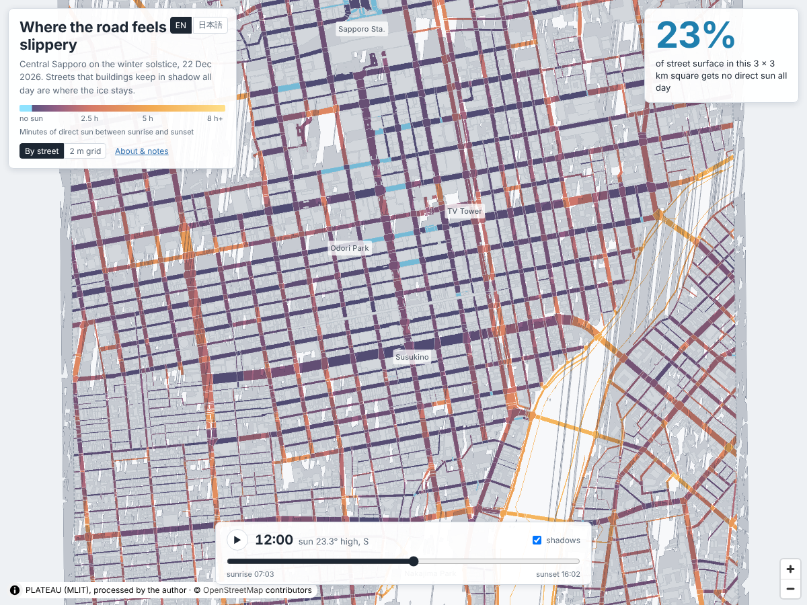

# Where the road feels slippery（つるつるの道は、影の中に）

#30DayMapChallenge 2026 · Day 28 · Senses: Feeling

**https://shinyanakashima.github.io/30daymapchallenge-2026day28-slippery-streets/**



In a Sapporo winter, the parts of a street that never see the sun stay icy long after the rest has melted — you feel it through the soles of your feet. This map estimates, from PLATEAU 3D building heights, which street surfaces in central Sapporo get no direct sun at all on the winter solstice (22 December 2026).

冬の札幌では、日が当たらない道は凍りやすく、足の裏で「つるつる」を感じます。この地図は、国土交通省 PLATEAU の3D都市モデルの建物の高さから、冬至（2026年12月22日）の1日に建物の影で日が当たらない道を計算したものです。画面は英語表記が基本で、右上のボタンで日本語に切り替えられます。

## 結果

| 項目 | 値 |
|---|---|
| 範囲 | 札幌市中央区・大通〜すすきの周辺の 3km 四方（中心 43.0575°N, 141.3530°E） |
| 日付 | 2026年12月22日（日の出 07:03、南中 11:32、日の入り 16:02、最大太陽高度 23.5°） |
| 道路面の面積（2m 格子） | 約 2.52 km²（3,543 区間） |
| **1日中日が当たらない道路面の割合** | **23.1%** |
| 道路面の平均日照時間 | 86 分（日の出から日の入りまでの 540 分のうち） |

## 画面

- **By street / 道ごと**: 道路の面ごとに、日が当たる時間の平均で塗り分けます。1日中日が当たらない道は氷の色（水色）、日が当たる道ほど暖かい色です。建物はうすい灰色です。
- **2 m grid / 2m 格子**: 2m 格子ごとの日照時間をそのまま表示します。東西の道の南側（建物のすぐ北）に、日が当たらない帯ができるのが見えます。
- 時刻のスライダー: 7:30〜16:00 の30分ごとの建物の影を表示します（▶ で再生）。
- 道をクリックすると、道路名（OpenStreetMap で分かる場合）、日が当たる時間の平均、1日中日が当たらない部分の割合、面積を表示します。
- 右上の大きな数字は、範囲内の道路面のうち1日中日が当たらない部分の割合です。

## 計算方法

1. **太陽の位置**: pvlib（0.16）で、2026年12月22日 0:00〜23:50（日本時間）の10分ごとに太陽の方位角と見かけの高度を求め、高度が0°より高い 54 時刻を使いました。1時刻を10分の日照として数えます。
2. **建物の影**: 建物を平らな屋根の柱とみなし、平面形（LOD0）を太陽と反対の方向へ「高さ ÷ tan（太陽の高さ）」だけずらした形と、壁ごとの平行四辺形をつなげて、その時刻の影としました（shapely 2.2）。地面は平らとみなしています。範囲の外側 1km までの建物も影を落とすものとして含めています。
3. **日照時間**: 範囲を 2m 格子（1,500 × 1,500）に分け、道路の面に中心が入る格子（630,556 個）について、各時刻の影に中心が入るかを判定し（rasterio で影の形を格子に焼き付け）、影に入らない時刻の数 × 10 分を日照時間としました。
4. **道ごとの値**: 道路の面ごとに、格子の日照時間の平均と、日照時間が 0 分の格子の割合を出しました。
5. **影のフレーム**: 30分ごとの時刻について、影の形をまとめて（union）0.4m で単純化し、GeoJSON にしました。

### 建物の高さの扱い

- `measuredHeight` が正の値の建物はその値を使いました（39,878 棟）。
- `measuredHeight` が無い（-9999）建物は、地上階数 × 3.0m で高さを推定しました（763 棟）。
- 高さも階数も無い建物はありませんでした（ある場合は除外する処理にしています）。

### 道路

PLATEAU の札幌市モデルに道路（tran）の面データ（LOD1）があるため、それを使いました。範囲の正方形で切り取り、1m² 未満の断片は除きました。道路名は PLATEAU に無いため、OpenStreetMap の道路線（歩道・階段などを除く）のうち、その道路の面と最も長く重なる線の `name` / `name:en` を付けました（3,543 区間のうち 1,338 区間）。

### 検算（pybdshadow）

[pybdshadow](https://github.com/ni1o1/pybdshadow) 0.3.5（BSD-3）を別の環境（Python 3.9）で動かし、範囲中心の 800m 四方（影を落とす建物 4,499 棟）について、9:00〜15:00 の1時間ごとの影を比べました。pybdshadow は太陽の位置に suncalc を使うため、高度に 0.03〜0.09° の差があります。

| 時刻 | 太陽高度（pvlib / suncalc） | 影の割合（本計算） | 影の割合（pybdshadow） | IoU |
|---|---|---|---|---|
| 09:00 | 14.84° / 14.76° | 98.0% | 98.0% | 0.997 |
| 10:00 | 20.19° / 20.14° | 90.5% | 90.2% | 0.987 |
| 11:00 | 23.11° / 23.07° | 78.8% | 79.5% | 0.973 |
| 12:00 | 23.25° / 23.22° | 92.0% | 92.1% | 0.987 |
| 13:00 | 20.60° / 20.56° | 96.7% | 96.7% | 0.995 |
| 14:00 | 15.46° / 15.42° | 98.9% | 99.0% | 0.998 |
| 15:00 | 8.36° / 8.27° | 100.0% | 100.0% | 1.000 |

IoU（重なりの面積 ÷ 合わせた面積）の平均は 0.991、最小は 0.973 で、大きなずれはありませんでした。

## 注記

- 建物の影だけで計算した目安です。実際に凍っているかを観測したものではありません。
- 木、雪山、看板、地面の起伏（西側の山を含む）は考慮していません。札幌の中心部にはロードヒーティングの道もあり、日が当たらなくても凍らない場合があります。
- 建物は平らな屋根の柱としています（屋根の形、ひさし、アーケードは考慮していません）。PLATEAU の札幌市モデルは 2020 年度のもので、その後に建った建物・解体された建物は反映されていません。
- 範囲の外側 1km より遠い建物の影は含めていません。日の出・日の入り直前の太陽が低い時刻は、範囲内のほぼ全体が影になります。

## データの出典

| データ | 取得元 | 取得日 |
|---|---|---|
| 建物・道路: 国土交通省 Project PLATEAU 札幌市3D都市モデル（2020年度、CityGML v4・仕様 4.1） | G空間情報センター [plateau-01100-sapporo-shi-2020](https://www.geospatial.jp/ckan/dataset/plateau-01100-sapporo-shi-2020)（ファイル `01100_sapporo-shi_city_2020_citygml_7_op.zip`） | 2026-11-07 |
| 道路名: © OpenStreetMap contributors（ODbL） | Overpass API（maps.mail.ru ミラー） | 2026-11-07 |

札幌市の PLATEAU データは 2020 年度のものが最新（唯一）です。地図の建物・道路・影・日照時間は、国土交通省 PLATEAU のデータを加工して作成したものです。

## 再現手順

```bash
pip install -r requirements.txt

# 1. 範囲の3次メッシュ（36 区画）の bldg / tran の CityGML だけを zip から取り出す
python scripts/fetch_plateau.py

# 2. PLATEAU GIS Converter（CLI 版 nusamai）で GeoPackage に変換
#    https://github.com/Project-PLATEAU/PLATEAU-GIS-Converter をビルド（cargo build --release -p nusamai）
#    ここではコミット e1c8fef（2026-02-06）をビルドして使用
NUSAMAI=/path/to/target/release/nusamai bash scripts/convert.sh

# 3. 道路名用の OpenStreetMap 道路線
python scripts/fetch_osm.py

# 4. 日照時間・影の計算（web/data/ に出力、10分強）
cd scripts && python compute.py

# 5. 検算（pybdshadow は Python 3.9 の別環境）
python validate.py prepare
uv venv -p 3.9 /path/to/venv && uv pip install -p /path/to/venv/bin/python pybdshadow
/path/to/venv/bin/python pybdshadow_run.py
python validate.py compare
cd ..

# 6. 表示の確認（コンソールエラーと 404 が無いこと、スクリーンショット 1200×900）
python -m http.server 8000 -d web &
node scripts/check_site.cjs http://localhost:8000/ docs/screenshot.png
```

中間ファイルは `work/`（git 管理外）に置かれます。公開は `main` への push で GitHub Actions（`.github/workflows/pages.yml`）が `web/` を GitHub Pages にデプロイします。

## 使用ライブラリ

MapLibre GL JS 4.7.1（BSD-3）、pvlib、shapely、geopandas、rasterio、pyproj、remotezip、pybdshadow（検算のみ）。

## License

Code: MIT（[LICENSE](LICENSE)）. Map data: PLATEAU（国土交通省）を加工して作成、© OpenStreetMap contributors（ODbL）.
